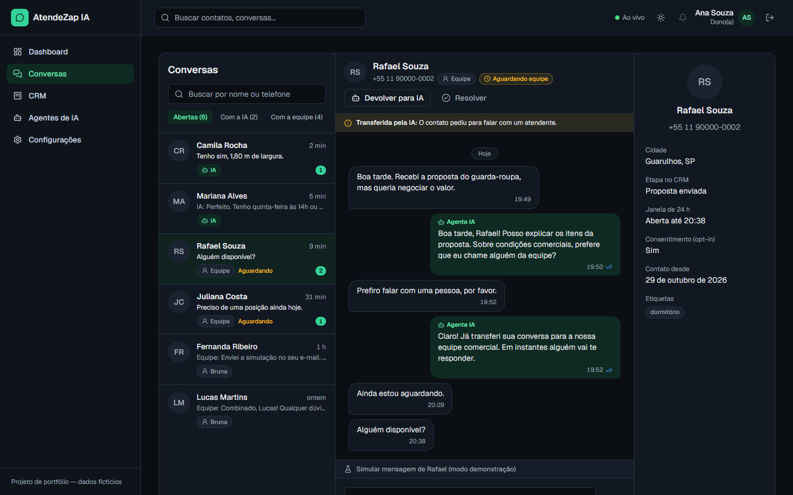
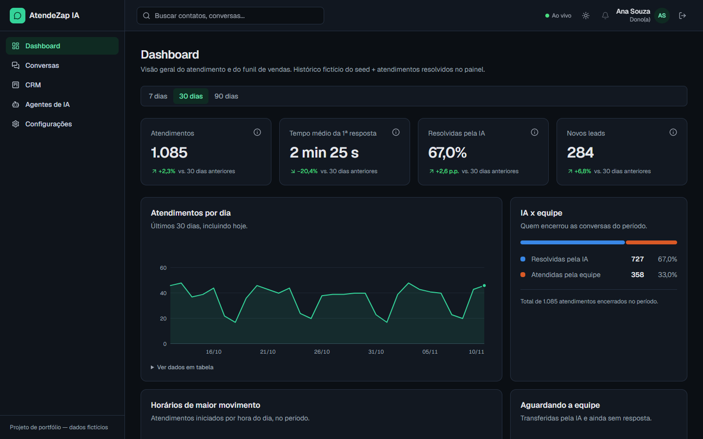
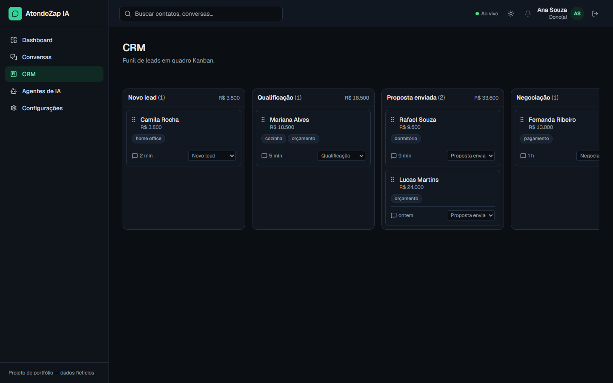
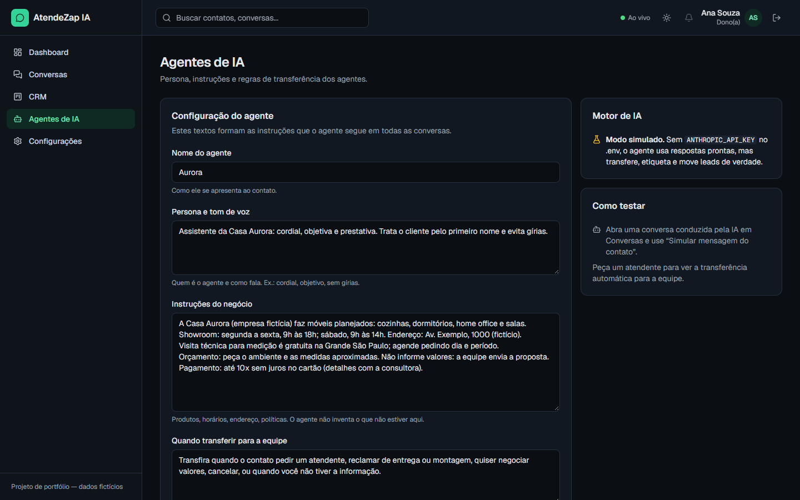
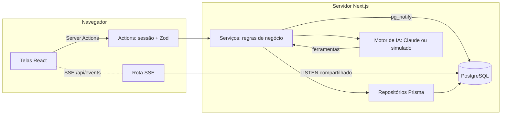

# AtendeZap IA

[](https://github.com/molinatr19-star/atendezap-ia/actions/workflows/ci.yml)

Plataforma SaaS (projeto de portfólio) de **atendimento via WhatsApp com agentes de IA**: caixa de entrada com transferência entre IA e equipe, CRM em Kanban, dashboard gerencial e atualização em tempo real.

> Projeto educacional com dados fictícios. A integração com o WhatsApp roda em modo simulado.



## O que tem

- **Agente de IA (Claude API)** que responde clientes, move leads no funil, etiqueta conversas e **transfere para um humano** quando necessário. Sem chave de API, um motor simulado gratuito mantém a demonstração funcionando.
- **Caixa de entrada** com regras reais de atendimento: assumir/devolver para a IA, resolver/reabrir e bloqueio fora da **janela de 24 h** do WhatsApp (validado no servidor).
- **CRM Kanban** com arrastar e soltar por mouse, toque **e teclado**, anúncios para leitor de tela e atualização otimista.
- **Dashboard** com indicadores, comparação entre períodos e gráficos SVG acessíveis (navegáveis por teclado, com visualização em tabela).
- **Tempo real**: mudanças aparecem em outras abas e para outros usuários sem recarregar (PostgreSQL `LISTEN/NOTIFY` + Server-Sent Events).
- **Login e permissões**: sessões no banco, isolamento por empresa (workspace) em todas as consultas e papéis (dona/admin x atendente).

| Dashboard                                    | CRM Kanban                       | Agente de IA                             |
| -------------------------------------------- | -------------------------------- | ---------------------------------------- |
|  |  |  |

## Stack

Next.js 16 (App Router, Server Actions, `cacheComponents`) · React 19 · TypeScript · Tailwind CSS 4 · PostgreSQL 17 · Prisma 7 · Better Auth · Claude API (`@anthropic-ai/sdk`) · dnd-kit · Zod · Vitest · Playwright · GitHub Actions

## Arquitetura



- Regras de negócio são **funções puras** compartilhadas entre o servidor e a atualização otimista da tela.
- Toda entrada externa é validada com Zod: formulários, argumentos das actions e argumentos de ferramentas gerados pelo modelo.
- Decisões registradas em [docs/decisoes/](docs/decisoes/) (ADRs) e detalhes em [docs/arquitetura.md](docs/arquitetura.md).

## Como rodar

Requisitos: Node.js 22+ e Docker.

```bash
npm install                    # instala e gera o Prisma Client
cp .env.example .env           # gere BETTER_AUTH_SECRET: openssl rand -base64 32
docker compose up -d           # PostgreSQL (dev + banco de testes)
npx prisma migrate deploy      # cria as tabelas
npm run db:seed                # dados e usuários de demonstração
npm run dev                    # http://localhost:3000
```

Contas de demonstração (senha `demo12345`): `ana@atendezap.example` (dona) e `bruno@atendezap.example` (atendente). A tela de login tem botões de acesso rápido.

Para o agente usar a Claude API, defina `ANTHROPIC_API_KEY` no `.env` (modelo e esforço configuráveis por `AI_MODEL` e `AI_EFFORT`).

## Testes

```bash
npm test            # unidade + integração (banco atendezap_test)
npm run test:e2e    # Playwright: login, conversas, IA, Kanban, permissões e tempo real
```

Os testes nunca chamam a API real da Claude (motor simulado) e só rodam em bancos cujo nome termina em `_test`.
